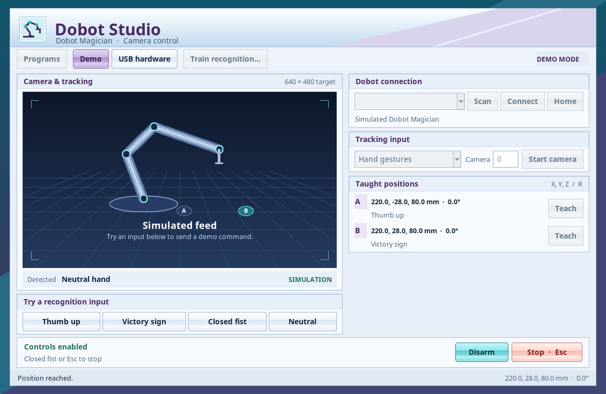
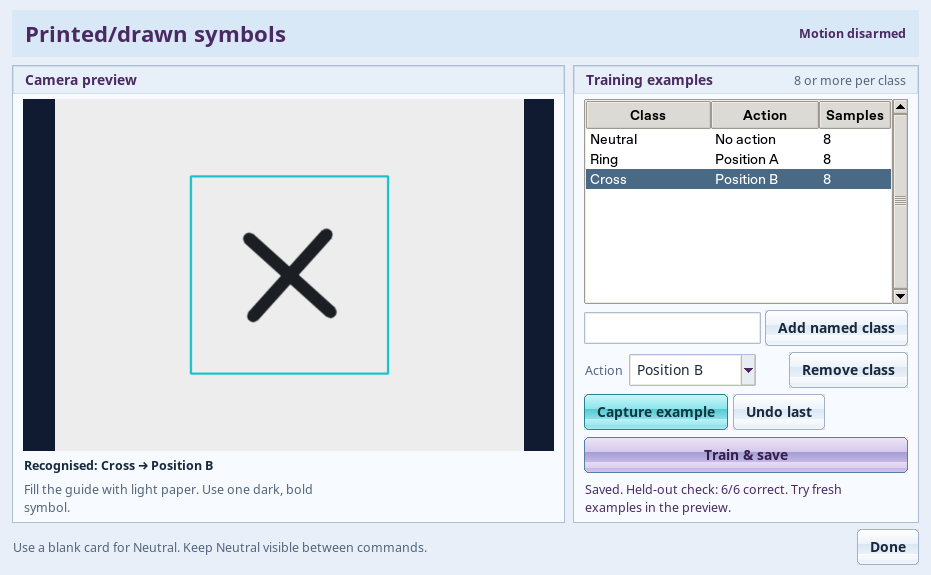
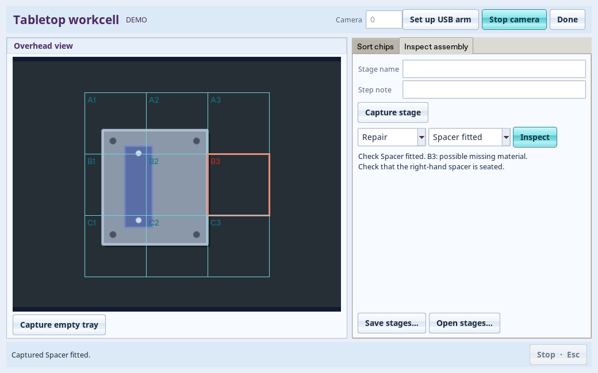
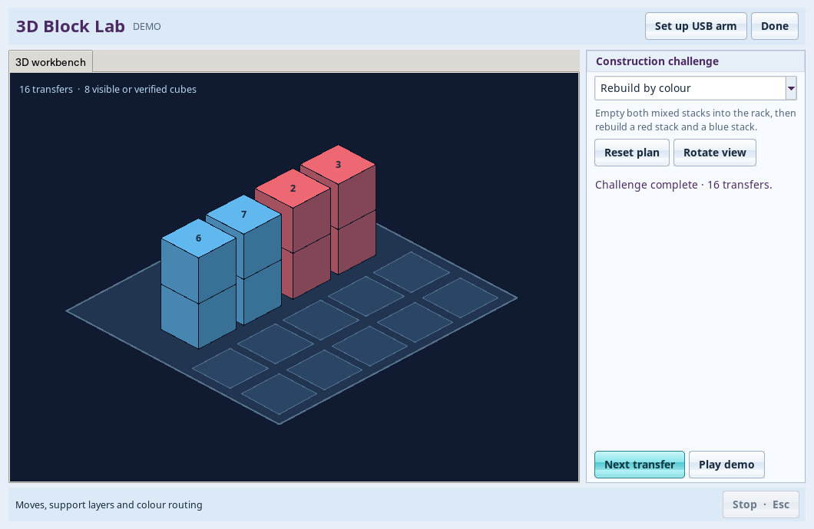
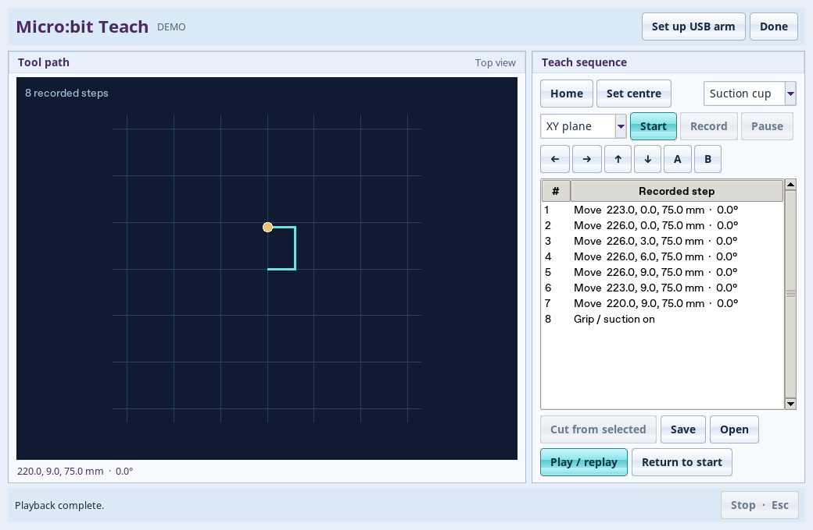
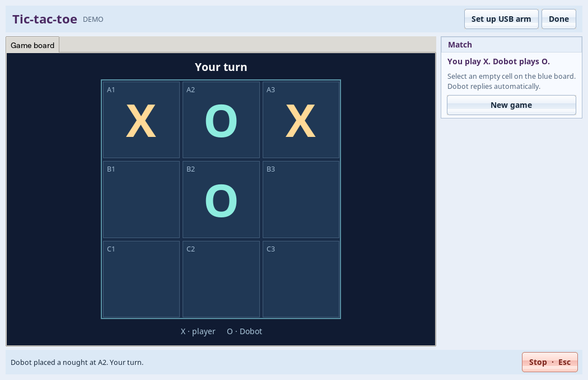
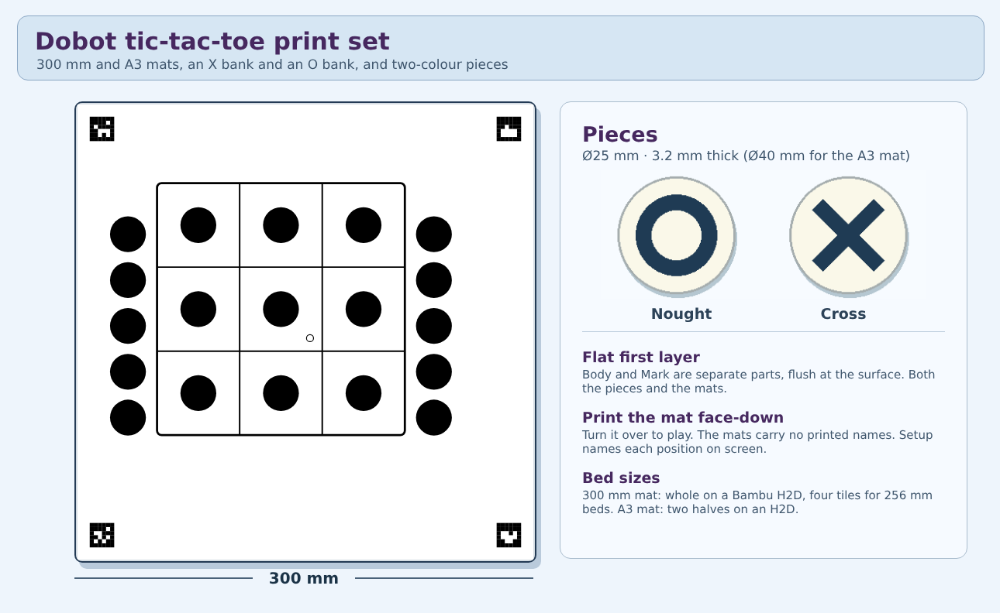

# Dobot Studio

A standalone Raspberry Pi 5 desktop app for the USB-connected Dobot Magician. A USB
webcam supplies hand gestures, body poses or trained symbols. The app processes frames in memory on
the Pi and talks directly to the arm over USB serial. It runs in a native Tk window,
with the teal, purple and glass styling of CircuitPath.

## Program overview


| Program | What you can do |
| --- | --- |
| [Gesture & pose control](#try-the-demo) | Use hand gestures or body poses to send the arm to a taught position or stop it. |
| [Recognition training](#train-custom-hand-signs-or-symbols) | Collect labelled examples of hand signs or symbols, check recognition, and map classes to actions. |
| [Chip sorting](#sort-tabletop-chips) | Scan a calibrated tray, estimate chip areas, and route colour or labelled chips to two taught bins. |
| [Assembly inspection](#inspect-a-tabletop-assembly) | Compare the tabletop with saved reference stages and review changes before building, repairing, or disassembling. |
| [3D Block Lab](#3d-block-lab) | Build a stepped pyramid or box, or separate mixed stacks and rebuild them by colour. |
| [Equation Lab](#equation-lab) | Read rows of number and operator chips, calculate answers, and place matching chips. |
| [Micro:bit Teach](#microbit-teach) | Use a Micro:bit to jog the arm, record tool actions, edit the path, and replay it. |
| [Tic-tac-toe](#tic-tac-toe) | Choose X or O and play on a camera-tracked mat. The Dobot takes its turns automatically. |

Use **Programs** to return to the picker when the camera and motion controls are idle.
Mount the USB camera overhead for sorting, equation reading, assembly inspection and tic-tac-toe.
Use a fixed angled view for 3D Block Lab. The screenshots show
the running desktop app in Demo mode. The training and tabletop views use
synthetic camera inputs.

## Try the demo



From the extracted folder on a desktop with Python 3 and Tk installed, run:

```sh
./launch.sh
```

On a system that does not preserve executable permissions, use `sh launch.sh`.
Choose **Gesture & pose control**, select **Enable controls**, then click **Thumb up** or **Victory sign** to move the
simulated arm to A or B. Try **Stop** or Escape. Change the tracking input to
**Body poses** to try that mapping. Demo mode starts by default and requires
neither a model nor a device.

## Install on Raspberry Pi 5

Use **64-bit Raspberry Pi OS with desktop**, a monitor or touchscreen, a USB
webcam, and an original Dobot Magician with its power supply and USB data cable.
Initial dependency and model downloads need internet access. Once installed, the app
works offline.

```sh
sudo apt update
sudo apt install -y python3-venv python3-tk curl libgl1 libegl1 libgles2 libportaudio2
sh setup-pi.sh
sh launch.sh
```

If serial connection fails with **Permission denied**, check the group on the USB
serial device with `ls -l /dev/ttyUSB*`. On Raspberry Pi OS that group is usually
`dialout`. If needed, run `sudo usermod -aG dialout "$USER"`, then sign out and
back in. Launch the app as your desktop user. Close other programs using the arm's
serial port. CP210x and CH340 adapters are typically handled by the OS.

## Train custom hand signs or symbols



The example maps a ring to position A and a cross to position B.

Training and recognition run on the Pi. Use **Demo** while experimenting so the
webcam can drive the simulated arm.

1. Choose **Custom hand signs** or **Printed/drawn symbols** under **Tracking input**,
   then click **Train recognition…**. The training window opens the camera and
   keeps motion disarmed.
2. Select **Neutral** and capture at least eight examples. Use a relaxed hand
   shape or a blank white card. Keep one whole hand visible. For symbols, fill
   the guide with light paper and show one bold, dark shape inside it.
3. Add a named class for each sign or symbol, choose **Position A**, **Position B**,
   **Stop** or **No action**, and capture at least eight examples per class. Vary
   distance, angle and lighting a little, as you would during normal use. Add
   similar-looking inputs as **No action** if they should never move the arm.
4. Click **Train & save**. The held-out check shows how many captured examples
   the classifier matched while setting them aside during fitting. Try fresh
   examples in the preview. Review unfamiliar shapes as well as known inputs.
   Capture more varied examples and train again when the classifier is uncertain
   or confuses classes.
5. Click **Done**. In Demo mode, enable controls and show Neutral between
   commands to try the mapped actions with the simulator. In USB hardware mode,
   follow the setup below before enabling motion.

Each mode keeps a separate profile with labels, action mappings and numerical
features in `~/.local/share/dobot-studio/training/` (or under `$XDG_DATA_HOME` if
set). Camera images are processed in memory. The app saves only when you click
**Train & save**. Use `./launch.sh --training-data PATH` for a different profile
folder. Custom hand signs reuse the MediaPipe hand model installed by the setup
script. Symbol mode uses OpenCV and the locally trained classifier.

## First hardware run

1. Keep the arm's workspace clear and have a physical way to stop it within reach.
   Power the Dobot with its own adapter. Plug its USB data cable and the webcam
   into the Pi.
2. In **USB hardware**, scan and select the arm's port. You can also type a stable
   path from `/dev/serial/by-id/` if one is available. Click **Connect**, then
   **Home**. Homing moves the arm.
3. With controls disarmed, use the Magician's hand-guiding button to position the
   tool. Release the button and let the arm settle, then click **Teach** for A.
   Repeat for B, and leave the tool at A or B. This prototype limits the two
   positions to 100 mm and 25° apart. Pick a short, clear straight path. Presets
   are held for the connected and homed session.
4. Choose a tracking input and start the camera (index `0` by default, or a
   Linux path such as `/dev/video2`). For either trained mode, save a profile
   first and confirm recognition in the preview. Click **Enable controls**.
   Show a neutral input before each new motion command, then hold the action
   input for about 350 ms.

| Action | Hand gestures | Body poses |
| --- | --- | --- |
| Position A | Thumb up | Raise your left wrist above your shoulder |
| Position B | Victory sign | Raise your right wrist above your shoulder |
| Stop and disarm | Closed fist | Raise both wrists |
| Neutral | Relaxed or open hand in view | Both wrists below shoulder height |

**Stop** and **Escape** disarm control. If motion is active, the app requests a
controller force-stop and clears pending commands. Tracking loss also disarms
control. An interrupted USB move requires homing and teaching again. If the USB
connection fails or the arm keeps moving, use the physical stop. Test
homing, short moves and stopping on the bench before using the app around others.

If the webcam opens with a blank or frozen view, try another device index or a
different USB port. If a model is missing, re-run `sh setup-pi.sh` or put the
two `.task` files in `models/`. To switch models during a session, stop the
camera, choose the other tracking input and restart it. `./launch.sh --models PATH`
accepts a different local model folder.

## Sort tabletop chips


The sample tray routes red chips to Bin A and blue chips to Bin B.

Select **Suction cup** or **Gripper** in the workcell. Use suction for flat,
nonporous chips and the gripper for thicker chips with accessible sides. Use
pieces of the same thickness. The sorter moves one isolated chip per approved
transfer. Demo mode combines camera routing with simulated arm coordinates.

1. Fix the overhead camera square to the tray. Use stable, even lighting and a
   matte surface that contrasts with the chips. Put three widely spaced marks
   in the reachable pickup area. Leave the arm outside the pickup view.
2. For hardware, connect and home the arm in **Gesture & pose control**, then
   open **Programs → Chip sorting**. Start the overhead camera and **Capture
   empty tray** with the reference marks in place. In Demo, use **Demo
   coordinates**. On the arm, select each mark, click its centre in the preview,
   hand-guide the fitted tool to the same XY at pickup height, and click
   **Teach point**. Teach **Bin A**, **Bin B** and **Park** the same way with the
   arm. Teach the bins at release height outside the pickup triangle, and park
   the tool outside the triangle at a clear travel height 12–75 mm above both
   the chips and the bin targets. Keep the same tool rotation.
3. Select **Colour** and assign two different colours to the bins, or choose
   **Trained text/symbols**. Train the latter in **Recognition training** with
   the same printed or drawn labels used on the chips. A class mapped to A or B
   goes to that bin. Keep labels bold, flat and consistently oriented.
4. Return the tool to Park. Place separated chips fully inside the triangle.
   **Scan tray** previews classification, destination and estimated visible area
   in mm². **Sort next** rechecks the first routable chip against a fresh frame,
   then asks for confirmation in hardware mode. Check the result and scan again.
   The counter records completed transfer commands. A successful suction grip
   still needs visual confirmation.

If the camera moves, the tray or tool changes height, or lighting changes
substantially, capture the empty tray and teach the marks again. A stop during
pickup may leave suction active. Support the chip before using **Release tool**.
Use the hardware stop if the USB connection fails. Exercise the full path with
an empty workspace and then one test chip before sorting a mixed tray.

## Inspect a tabletop assembly



The example compares a bracket base with the **Spacer fitted** reference stage.

Use a fixed camera, a repeatable fixture and even lighting. **Capture empty tray**
is optional and helps distinguish possible missing material from extra material.
In **Assembly inspection**:

1. Put a known good assembly stage in the central grid. Enter a stage name and an
   optional note, such as “Fit the second spacer”. Click **Capture stage**.
   Repeat in build order. **Save stages** keeps the reference views and notes in a
   local file to open in a future session.
2. Place the assembly to check in the same fixture. Choose a reference and
   **Build**, **Repair** or **Disassemble**, then click **Inspect**.
3. Review the highlighted grid zones and the report. A matching Build stage
   points to the next saved stage. Disassemble points to the preceding saved stage.
   Repair shows possible missing, extra or changed regions to check.

Inspection is a 2D comparison of visible stages. It provides operator guidance
for known assemblies. It cannot see hidden parts, infer 3D fit, diagnose internal
faults, or execute a repair or assembly sequence.

For STEM activities, compare colour or label counts before and after sorting,
compare measured chip areas against known dimensions, or use the inspection
grid for a manufacturing quality-control exercise.

## 3D Block Lab



Choose **Stepped pyramid**, **Block box**, or **Rebuild by colour**. **Next transfer**
advances one block and **Play demo** runs the challenge with a simulated arm.
Use **Rotate view** to see the supporting layers. In the colour challenge, the
planner removes exposed cubes to the rack before rebuilding a red structure and
a blue structure.

For hardware, print the [fixture and marker cards](docs/block-fixture.pdf)
at **Actual Size** and check the 120 mm scale line. Use light, rigid 20 mm cubes
with a 12 mm ArUco marker centred on each top face. IDs 0–3 are red and 4–7 blue.
IDs 8–9 are additional red cubes for the build challenges. In hardware use
only the cubes and fixture the program knows.

1. Fix the webcam at an angle where it can see the cube tops and all four marker
   anchors. Orient the anchor cards as shown on the fixture. Place them at
   exactly 20 mm above the board and select **Calibrate layer 1**. Raise the same
   anchors to 40 mm at the same XY positions and select **Calibrate layer 2**.
   Return the anchors to 20 mm and keep them visible.
2. Connect and home the arm. Select the fitted attachment in Block Lab. Put a
   reference cube at the left datum and hand-guide the tool to its pickup
   contact pose. Select **Left datum** and click **Teach tool pose**. Repeat for
   the right datum, 120 mm away. Teach **Park** outside the assembly at a
   clearance height at least 12 mm above the highest cube. Set the same tool
   rotation at both datums and Park. Re-teach after changing the tool.
3. Start the build challenges with a clear target zone and five or eight cubes
   in the rack. For **Rebuild by colour**, start with IDs 0–7 in the two-level
   rows nearest the rack in the build zones, as shown by the Demo setup. Return
   the tool to Park and keep the scene still.
4. Review each **Next transfer**. Confirm travel clearance and, with the
   gripper, clearance for both jaws around the source and destination.
   After returning to Park, the app checks the marker at the expected position
   and height before the next transfer. Check the fixture if it reports an
   ambiguous marker or unconfirmed placement.

The camera distinguishes two calibrated heights on this known fixture.
Use the angled view and taught geometry for tagged block activities. Camera
calibration, attachment clearance, and pick-and-place reliability need a
bench check with the actual Dobot before classroom operation.

## Equation Lab


1. In **Recognition training**, train **Printed/drawn symbols** using your
   physical number and operator chips. Use labels such as `0`–`9`, `Plus`,
   `Minus`, `Times`, `Divide` and `Equals`. Map maths classes to
   **No action**. For Neutral, use a blank card. Keep the same chip print
   and orientation for training and reading.
2. Start the overhead camera and capture the empty tray. Teach the three
   pickup marks under **Sort chips** or select **Demo coordinates**.
   In **Equation Lab**, select **Set divider** and click the camera preview
   between the equation area and the answer bank.
3. Lay out one or more separated rows fully inside the calibrated triangle.
   The app reads left to right, joins adjacent digits into one number, and uses
   standard operator precedence. An equals sign or `= ?` at the end is
   optional. Select **Read equations**, then choose the row to check.
   Fractions are displayed exactly.
4. For physical placement, place matching answer chips below the divider.
   Teach **Bin A** as the first answer spot and **Bin B** as the far end of a
   clear answer line outside the pickup triangle. Teach **Park** and select
   the fitted tool. For a whole-number answer, **Place next answer chip**
   moves one matching digit or minus chip at a time, 30 mm apart. Confirm each
   move and check the answer line before moving to another equation.

## Micro:bit Teach



1. Flash [microbit/teach.py](microbit/teach.py) onto the BBC micro:bit using
   MicroPython. Connect it to the Pi by USB and keep the cable clear of the
   robot. The Micro:bit normally appears as `/dev/ttyACM0`. The separate
   Dobot port is usually `/dev/ttyUSB0`.
2. Open **Micro:bit Teach** in **USB hardware** mode and connect both devices.
   Select the fitted **Suction cup** or **Gripper**, then **Home**. If needed,
   hand-guide the tool to a clear centre and click **Set centre**. Hold the
   Micro:bit still in neutral and select **Start**.
3. Tilt to jog and return to neutral to stop requesting moves. Enable
   **Hold A+B to jog** before Start if you prefer a hand-held clutch.
   **XY plane** jogs two horizontal axes. **Z height** uses tilt for small
   height changes. Hold **A** briefly on its own to turn suction on or close
   the gripper. Hold **B** briefly to release. The accelerometer supplies
   tilt input. The app records the resulting tool path in taught coordinates.
4. Click **Record**, then jog and operate the tool. **Pause** suspends after
   the current step. **Resume** continues, and **Stop** ends teaching.
   Select a timeline step and **Cut from selected** to remove its tail.
   **Save** and **Open** use local JSON path files.
5. Fit the recorded tool and position it at the first recorded pose.
   **Play / replay** moves through the recorded poses and tool actions.
   From the recorded end, **Return to start** retraces positions.
   Support and release any load before returning. Clear the workspace for
   every replay. Demo mode uses the on-screen arrows and A/B controls.

The two Dobot attachments use the same USB serial driver as the arm. The app
sends the manufacturer’s suction and pneumatic gripper commands for the selected
tool. The Micro:bit sends teaching input over its USB UART. These workflows use
the Pi setup dependencies already listed above. [Dobot serial protocol](https://download.dobot.cc/development-protocol/dobot-magician/pdf/en/Dobot-Magician-Communication-Protocol-V1.1.3.pdf) · [Micro:bit USB UART](https://microbit-micropython.readthedocs.io/en/latest/uart.html)

## Tic-tac-toe



Choose **Tic-tac-toe** from the picker, choose X or O under **Play as**, and start
a new game. X goes first. In Demo mode, click an empty cell to play your turn.

[Download the print set](printables/tictactoe-300mm.zip) or
[browse the 3D and paper mat files](printables/tictactoe/README.md).
The 3D files include a **300 × 300 mm** mat, four **150 × 150 mm** tiles and
flush, two-colour **Ø25 mm** playing pieces. Keep the supplied print orientation
so each mark begins on the first layer. Flip each piece mark side up for play.

For a paper mat, use the [300 mm SVG](printables/tictactoe/mat-300x300.svg) or
[full-size A3 PDF](printables/tictactoe/mat-a3.pdf). The A3 layout has 5 mm print
margins and uses [Ø40 mm tokens](printables/tictactoe/a3-pieces). The 300 mm SVG
uses Ø25 mm tokens. Print at Actual Size and check the A3 sheet's 100 mm line.
The play and reserve spots are hollow rings, with an X bank on the left and an
O bank on the right. Use the small Park ring as a guide for the tool's clearance
position. The four corner codes register the mat with the camera.



### Set up the physical game

1. Secure the mat flat with both reserves and all nine cells in reach. Attach
   the four marker cards if using the 3D mat. Mount the webcam overhead and
   frame all four markers. Select **USB hardware**, connect the Magician with
   the suction cup fitted, and home it.
2. Open **Tic-tac-toe** and start the camera. Remove all pieces, then choose
   **Capture empty mat**. The app registers the layout from its markers.
3. For each play cell and reserve slot, centre a sample piece and hand-guide
   the cup to the centre of its flat top. Click **Teach tool position**.
   The picker advances to the next position. Teach **Park** at a clear height
   above the guide using the same tool rotation. Return the tool to Park and
   remove the sample piece. If the tool is visible over the mat, capture the
   empty mat again with the tool at Park. Re-teach after moving the mat or
   changing layouts.
4. Choose **Play as**. For the paper mat, load X1–X5 with crosses and at least
   four of O1–O5 with noughts. On the single-bank mat, put the Dobot’s mark in
   the reserve slots. Load five if it plays X or four if it plays O. Select
   **New game**.
5. On your turn, centre one piece in an empty cell and take your hand away.
   Once the camera sees one legal move and a clear, unchanged mat for 1.5
   seconds, the Dobot makes its move. A change, obstruction or lost camera view
   restarts the countdown. If you play O, the Dobot opens after the same check.
   The camera verifies the destination and the cleared reserve slot after transfer.
6. Keep hands clear until the tool returns to Park and the screen shows your
   turn. Use **Stop** or Escape to interrupt. Support any held piece before using
   **Release suction**. Watch the first lift and placement to check reach and suction.


The camera and suction examples use simulated hardware. Print scale, camera
contrast, reach and suction sealing need checking with the physical setup.

## References

- The [Electromaker tutorial](https://www.electromaker.io/project/view/kicker10bogdobotmagicianserver) informed the Pi USB setup, serial port selection and homing workflow.
- The [pydobot driver](https://github.com/luismesas/pydobot) and [Dobot Magician serial protocol](https://download.dobot.cc/product-manual/dobot-magician/pdf/en/Dobot-Communication-Protocol-V1.1.5.pdf) informed the standalone serial adapter.
- The [CircuitPath theme](https://github.com/jackallen28/BNTS_Circuit_Pathways/blob/BNTS_CircuitPath/ui/theme.css) informed the desktop styling.
- The [MediaPipe Python setup guide](https://developers.google.com/edge/mediapipe/solutions/setup_python), [Gesture Recognizer](https://developers.google.com/edge/mediapipe/solutions/vision/gesture_recognizer) and [Pose Landmarker](https://developers.google.com/edge/mediapipe/solutions/vision/pose_landmarker) cover the tracking models.

- The [Dobot Vision Kit starter guide](https://github.com/SERLatBTH/StarterGuide-DobotMagicianVisionKit/tree/master) informed the three-point camera-to-robot calibration, colour sorting and taught bin workflow.
