# Dobot Studio

A standalone Raspberry Pi 5 desktop app for the USB-connected Dobot Magician. A USB
webcam supplies hand gestures, body poses or trained symbols. The app processes frames in memory on
the Pi and talks directly to the arm over USB serial. It runs in a native Tk window,
with the teal, purple and glass styling of CircuitPath.

## Program overview

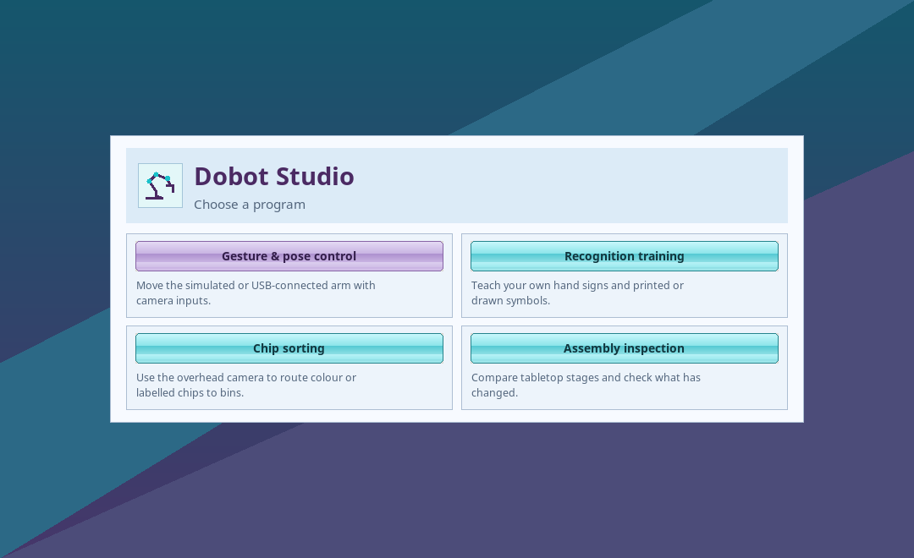

| Program | What you can do |
| --- | --- |
| [Gesture & pose control](#try-the-demo) | Use hand gestures or body poses to send the arm to a taught position or stop it. |
| [Recognition training](#train-custom-hand-signs-or-symbols) | Collect labelled examples of hand signs or symbols, check recognition, and map classes to actions. |
| [Chip sorting](#sort-tabletop-chips) | Scan a calibrated tray, estimate chip areas, and route colour or labelled chips to two taught bins. |
| [Assembly inspection](#inspect-a-tabletop-assembly) | Compare the tabletop with saved reference stages and review changes before building, repairing, or disassembling. |
| [3D Block Lab](#3d-block-lab) | Build a stepped pyramid or box, or separate mixed stacks and rebuild them by colour. |
| [Equation Lab](#equation-lab) | Read rows of number and operator chips, calculate answers, and place matching chips. |
| [Micro:bit Teach](#microbit-teach) | Use a Micro:bit to jog the arm, record tool actions, edit the path, and replay it. |
| [Tic-tac-toe](#tic-tac-toe) | Choose X or O and play on a camera-tracked mat. The Dobot takes its turns automatically, then resets the board. |

Use **Programs** to return to the picker when the camera and motion controls are idle.
Mount the USB camera overhead for sorting, equation reading, assembly inspection and tic-tac-toe.
Use a fixed angled view for 3D Block Lab. The screenshots show
the running desktop app in Demo mode. The training and tabletop views use
synthetic camera inputs.

## Try the demo


From the extracted folder on a desktop with Python 3 and Tk installed, run:

```sh
./launch.sh
```

On a system that does not preserve executable permissions, use `sh launch.sh`.
Choose **Gesture & pose control**, select **Enable controls**, then click **Thumb up** or **Victory sign** to move the
simulated arm to A or B. Try **Stop** or Escape. Change the tracking input to
**Body poses** to try that mapping. Demo mode starts by default and requires
neither a model nor a device.

## Install on Raspberry Pi 5

Use **64-bit Raspberry Pi OS with desktop**, a monitor or touchscreen, a USB
webcam, and an original Dobot Magician with its power supply and USB data cable.
Initial dependency and model downloads need internet access. Once installed, the app
works offline.

To keep it up to date later, install it with git, which also lets the app update itself:

```sh
sudo apt update
sudo apt install -y git python3-venv python3-tk curl libgl1 libegl1 libgles2 libportaudio2 v4l-utils
git clone -b codex/dobot-studio https://github.com/jackallen28/BNTS_Circuit_Pathways.git
cd BNTS_Circuit_Pathways/apps/dobot-studio
sh setup-pi.sh
```

`setup-pi.sh` also adds a **Dobot Studio icon** to the desktop and the applications menu, so from
then on you just double-click it. (`sh launch.sh` starts it from a terminal.)

### The desktop icon

Double-click **Dobot Studio** on the desktop. The first time, Raspberry Pi OS may ask whether to
execute the file. Choose **Execute**, and tick the box to stop it asking again. The same icon is in the
applications menu. If you installed before the icon existed, it is added the first time you start the
updated app, once. To add it by hand or remove it:

```sh
sh install-desktop.sh
sh install-desktop.sh --remove
```

If you move the Dobot Studio folder, run `sh install-desktop.sh` again so the icon points at the new place.

### Check for updates

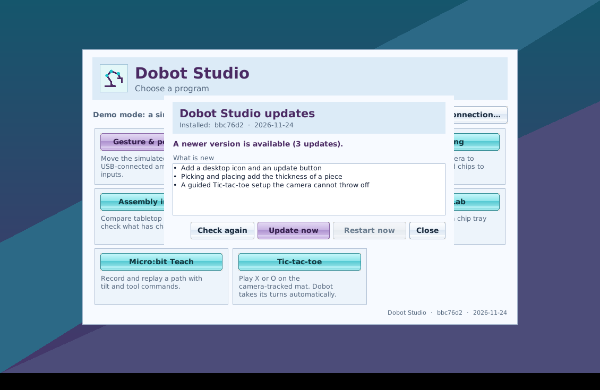

Click **Check for updates…** on the Connect screen or the programs page. It asks GitHub, tells you
the version you have, and lists what is new. **Update now** brings it up to date, installs any new
Python packages it needs, and **Restart now** starts the new version. The Pi needs internet for this.

It is careful with your copy:

- It only ever **fast-forwards**. It never merges, rewrites or throws anything away.
- If you changed a file on this copy that the update also changes, it **stops and names the file**
  instead of overwriting your change. Files it does not touch, and untracked files such as `models/`,
  are left alone.
- It will not update while the arm is moving or controls are enabled.
- It never waits for a password. If GitHub needs a sign-in for this copy, it says so. Run `git pull`
  once in the Dobot Studio folder and enter your login. `git config --global credential.helper store`
  stops it asking again.
- If this copy was not installed with git (for example, from a zip file), it says so and cannot
  update itself. Install it with the commands above.

The first time you move to a version that has this button, update by hand once:
`cd BNTS_Circuit_Pathways/apps/dobot-studio && git pull`, then start the app.

If serial connection fails with **Permission denied**, check the group on the USB
serial device with `ls -l /dev/ttyUSB*`. On Raspberry Pi OS that group is usually
`dialout`. If needed, run `sudo usermod -aG dialout "$USER"`, then sign out and
back in. Launch the app as your desktop user. Close other programs using the arm's
serial port. CP210x and CH340 adapters are typically handled by the OS.

## Train custom hand signs or symbols


The example maps a ring to position A and a cross to position B.

Training and recognition run on the Pi. Use **Demo** while experimenting so the
webcam can drive the simulated arm.

1. Choose **Custom hand signs** or **Printed/drawn symbols** under **Tracking input**,
   then click **Train recognition…**. The training window opens the camera and
   keeps motion disarmed.
2. Select **Neutral** and capture at least eight examples. Use a relaxed hand
   shape or a blank white card. Keep one whole hand visible. For symbols, fill
   the guide with light paper and show one bold, dark shape inside it.
3. Add a named class for each sign or symbol, choose **Position A**, **Position B**,
   **Stop** or **No action**, and capture at least eight examples per class. Vary
   distance, angle and lighting a little, as you would during normal use. Add
   similar-looking inputs as **No action** if they should never move the arm.
4. Click **Train & save**. The held-out check shows how many captured examples
   the classifier matched while setting them aside during fitting. Try fresh
   examples in the preview. Review unfamiliar shapes as well as known inputs.
   Capture more varied examples and train again when the classifier is uncertain
   or confuses classes.
5. Click **Done**. In Demo mode, enable controls and show Neutral between
   commands to try the mapped actions with the simulator. In USB hardware mode,
   follow the setup below before enabling motion.

Each mode keeps a separate profile with labels, action mappings and numerical
features in `~/.local/share/dobot-studio/training/` (or under `$XDG_DATA_HOME` if
set). Camera images are processed in memory. The app saves only when you click
**Train & save**. Use `./launch.sh --training-data PATH` for a different profile
folder. Custom hand signs reuse the MediaPipe hand model installed by the setup
script. Symbol mode uses OpenCV and the locally trained classifier.

## First hardware run

1. Keep the arm's workspace clear and have a physical way to stop it within reach.
   Power the Dobot with its own adapter. Plug its USB data cable and the webcam
   into the Pi.
2. Dobot Studio opens on **Connect your Dobot**, before the programs page. Choose the
   arm's port (**Scan** finds it, or type a stable path from `/dev/serial/by-id/`), click
   **Connect**, then **Home**. Homing moves the arm. Then **try it**: move the tool in
   small steps (1, 5, 10 or 20 mm) with the arrow buttons, and turn the suction on and
   off, or close and open the gripper. The steps refuse any point the arm cannot reach, **Stop**
   or Esc stops a move, and **Choose a program** unlocks once the arm is homed. **Use Demo
   mode** skips the arm. The picker has a **Dobot connection…** button to come back.

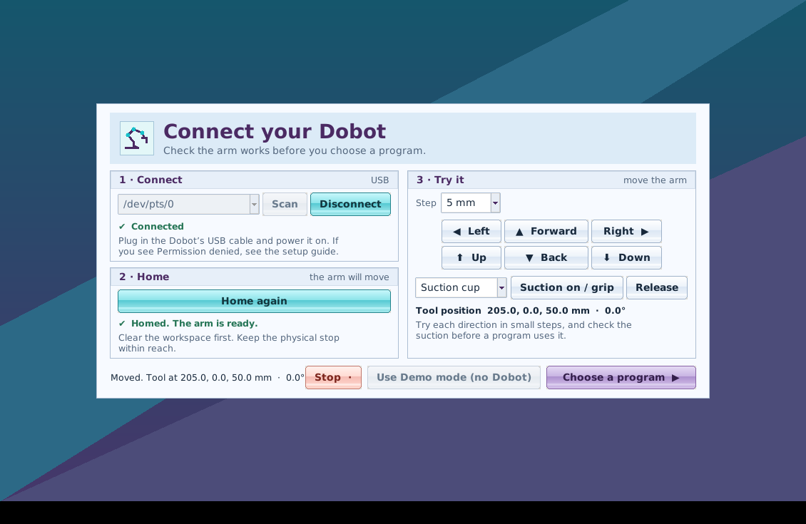

3. With controls disarmed, use the Magician's hand-guiding button to position the
   tool. Release the button and let the arm settle, then click **Teach** for A.
   Repeat for B, and leave the tool at A or B. This prototype limits the two
   positions to 100 mm and 25° apart. Pick a short, clear straight path. Presets
   are held for the connected and homed session.
4. Choose a tracking input and start the camera (index `0` by default, or a
   Linux path such as `/dev/video2`). For either trained mode, save a profile
   first and confirm recognition in the preview. Click **Enable controls**.
   Show a neutral input before each new motion command, then hold the action
   input for about 350 ms.

| Action | Hand gestures | Body poses |
| --- | --- | --- |
| Position A | Thumb up | Raise your left wrist above your shoulder |
| Position B | Victory sign | Raise your right wrist above your shoulder |
| Stop and disarm | Closed fist | Raise both wrists |
| Neutral | Relaxed or open hand in view | Both wrists below shoulder height |

**Stop** and **Escape** disarm control. If motion is active, the app requests a
controller force-stop and clears pending commands. Tracking loss also disarms
control. An interrupted USB move requires homing and teaching again. If the USB
connection fails or the arm keeps moving, use the physical stop. Test
homing, short moves and stopping on the bench before using the app around others.

If the webcam opens with a blank or frozen view, try another device index or a
different USB port. If a model is missing, re-run `sh setup-pi.sh` or put the
two `.task` files in `models/`. To switch models during a session, stop the
camera, choose the other tracking input and restart it. `./launch.sh --models PATH`
accepts a different local model folder.

## Sort tabletop chips

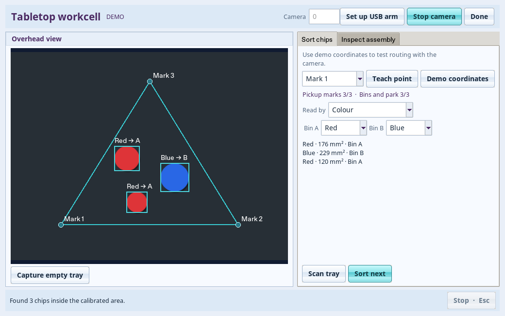

The sample tray routes red chips to Bin A and blue chips to Bin B.

Select **Suction cup** or **Gripper** in the workcell. Use suction for flat,
nonporous chips and the gripper for thicker chips with accessible sides. Use
pieces of the same thickness. The sorter moves one isolated chip per approved
transfer. Demo mode combines camera routing with simulated arm coordinates.

1. Fix the overhead camera square to the tray. Use stable, even lighting and a
   matte surface that contrasts with the chips. Put three widely spaced marks
   in the reachable pickup area. Leave the arm outside the pickup view.
2. For hardware, connect and home the arm in **Gesture & pose control**, then
   open **Programs → Chip sorting**. Start the overhead camera and **Capture
   empty tray** with the reference marks in place. In Demo, use **Demo
   coordinates**. On the arm, select each mark, click its centre in the preview,
   hand-guide the fitted tool to the same XY at pickup height, and click
   **Teach point**. Teach **Bin A**, **Bin B** and **Park** the same way with the
   arm. Teach the bins at release height outside the pickup triangle, and park
   the tool outside the triangle at a clear travel height 12–75 mm above both
   the chips and the bin targets. Keep the same tool rotation.
3. Select **Colour** and assign two different colours to the bins, or choose
   **Trained text/symbols**. Train the latter in **Recognition training** with
   the same printed or drawn labels used on the chips. A class mapped to A or B
   goes to that bin. Keep labels bold, flat and consistently oriented.
4. Return the tool to Park. Place separated chips fully inside the triangle.
   **Scan tray** previews classification, destination and estimated visible area
   in mm². **Sort next** rechecks the first routable chip against a fresh frame,
   then asks for confirmation in hardware mode. Check the result and scan again.
   The counter records completed transfer commands. A successful suction grip
   still needs visual confirmation.

If the camera moves, the tray or tool changes height, or lighting changes
substantially, capture the empty tray and teach the marks again. A stop during
pickup may leave suction active. Support the chip before using **Release tool**.
Use the hardware stop if the USB connection fails. Exercise the full path with
an empty workspace and then one test chip before sorting a mixed tray.

## Inspect a tabletop assembly


The example compares a bracket base with the **Spacer fitted** reference stage.

Use a fixed camera, a repeatable fixture and even lighting. **Capture empty tray**
is optional and helps distinguish possible missing material from extra material.
In **Assembly inspection**:

1. Put a known good assembly stage in the central grid. Enter a stage name and an
   optional note, such as “Fit the second spacer”. Click **Capture stage**.
   Repeat in build order. **Save stages** keeps the reference views and notes in a
   local file to open in a future session.
2. Place the assembly to check in the same fixture. Choose a reference and
   **Build**, **Repair** or **Disassemble**, then click **Inspect**.
3. Review the highlighted grid zones and the report. A matching Build stage
   points to the next saved stage. Disassemble points to the preceding saved stage.
   Repair shows possible missing, extra or changed regions to check.

Inspection is a 2D comparison of visible stages. It provides operator guidance
for known assemblies. It cannot see hidden parts, infer 3D fit, diagnose internal
faults, or execute a repair or assembly sequence.

For STEM activities, compare colour or label counts before and after sorting,
compare measured chip areas against known dimensions, or use the inspection
grid for a manufacturing quality-control exercise.

## 3D Block Lab


Choose **Stepped pyramid**, **Block box**, or **Rebuild by colour**. **Next transfer**
advances one block and **Play demo** runs the challenge with a simulated arm.
Use **Rotate view** to see the supporting layers. In the colour challenge, the
planner removes exposed cubes to the rack before rebuilding a red structure and
a blue structure.

For hardware, print the [fixture and marker cards](docs/block-fixture.pdf)
at **Actual Size** and check the 120 mm scale line. Use light, rigid 20 mm cubes
with a 12 mm ArUco marker centred on each top face. IDs 0–3 are red and 4–7 blue.
IDs 8–9 are additional red cubes for the build challenges. In hardware use
only the cubes and fixture the program knows.

1. Fix the webcam at an angle where it can see the cube tops and all four marker
   anchors. Orient the anchor cards as shown on the fixture. Place them at
   exactly 20 mm above the board and select **Calibrate layer 1**. Raise the same
   anchors to 40 mm at the same XY positions and select **Calibrate layer 2**.
   Return the anchors to 20 mm and keep them visible.
2. Connect and home the arm. Select the fitted attachment in Block Lab. Put a
   reference cube at the left datum and hand-guide the tool to its pickup
   contact pose. Select **Left datum** and click **Teach tool pose**. Repeat for
   the right datum, 120 mm away. Teach **Park** outside the assembly at a
   clearance height at least 12 mm above the highest cube. Set the same tool
   rotation at both datums and Park. Re-teach after changing the tool.
3. Start the build challenges with a clear target zone and five or eight cubes
   in the rack. For **Rebuild by colour**, start with IDs 0–7 in the two-level
   rows nearest the rack in the build zones, as shown by the Demo setup. Return
   the tool to Park and keep the scene still.
4. Review each **Next transfer**. Confirm travel clearance and, with the
   gripper, clearance for both jaws around the source and destination.
   After returning to Park, the app checks the marker at the expected position
   and height before the next transfer. Check the fixture if it reports an
   ambiguous marker or unconfirmed placement.

The camera distinguishes two calibrated heights on this known fixture.
Use the angled view and taught geometry for tagged block activities. Camera
calibration, attachment clearance, and pick-and-place reliability need a
bench check with the actual Dobot before classroom operation.

## Equation Lab

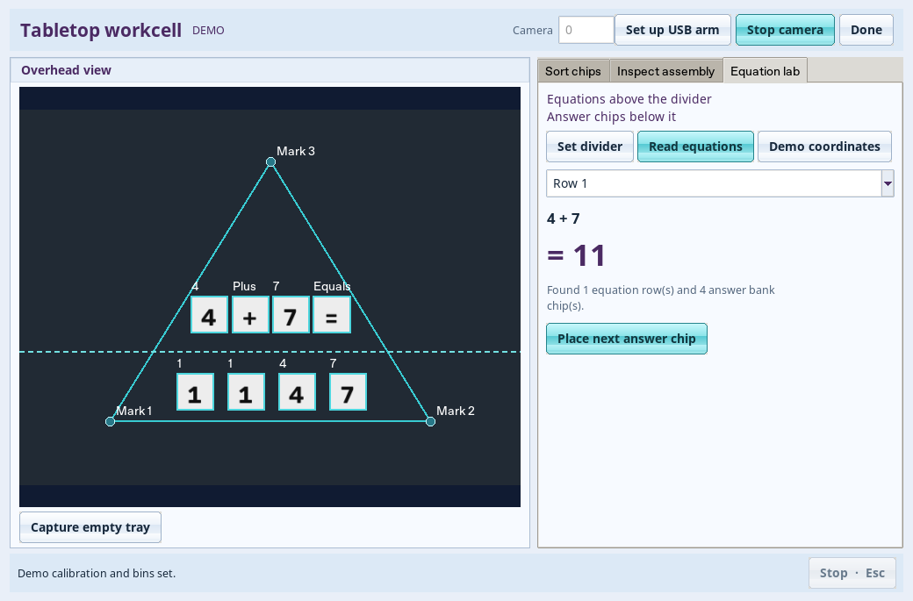

1. In **Recognition training**, train **Printed/drawn symbols** using your
   physical number and operator chips. Use labels such as `0`–`9`, `Plus`,
   `Minus`, `Times`, `Divide` and `Equals`. Map maths classes to
   **No action**. For Neutral, use a blank card. Keep the same chip print
   and orientation for training and reading.
2. Start the overhead camera and capture the empty tray. Teach the three
   pickup marks under **Sort chips** or select **Demo coordinates**.
   In **Equation Lab**, select **Set divider** and click the camera preview
   between the equation area and the answer bank.
3. Lay out one or more separated rows fully inside the calibrated triangle.
   The app reads left to right, joins adjacent digits into one number, and uses
   standard operator precedence. An equals sign or `= ?` at the end is
   optional. Select **Read equations**, then choose the row to check.
   Fractions are displayed exactly.
4. For physical placement, place matching answer chips below the divider.
   Teach **Bin A** as the first answer spot and **Bin B** as the far end of a
   clear answer line outside the pickup triangle. Teach **Park** and select
   the fitted tool. For a whole-number answer, **Place next answer chip**
   moves one matching digit or minus chip at a time, 30 mm apart. Confirm each
   move and check the answer line before moving to another equation.

## Micro:bit Teach


1. Flash [microbit/teach.py](microbit/teach.py) onto the BBC micro:bit using
   MicroPython. Connect it to the Pi by USB and keep the cable clear of the
   robot. The Micro:bit normally appears as `/dev/ttyACM0`. The separate
   Dobot port is usually `/dev/ttyUSB0`.
2. Open **Micro:bit Teach** in **USB hardware** mode and connect both devices.
   Select the fitted **Suction cup** or **Gripper**, then **Home**. If needed,
   hand-guide the tool to a clear centre and click **Set centre**. Hold the
   Micro:bit still in neutral and select **Start**.
3. Tilt to jog and return to neutral to stop requesting moves. Enable
   **Hold A+B to jog** before Start if you prefer a hand-held clutch.
   **XY plane** jogs two horizontal axes. **Z height** uses tilt for small
   height changes. Hold **A** briefly on its own to turn suction on or close
   the gripper. Hold **B** briefly to release. The accelerometer supplies
   tilt input. The app records the resulting tool path in taught coordinates.
4. Click **Record**, then jog and operate the tool. **Pause** suspends after
   the current step. **Resume** continues, and **Stop** ends teaching.
   Select a timeline step and **Cut from selected** to remove its tail.
   **Save** and **Open** use local JSON path files.
5. Fit the recorded tool and position it at the first recorded pose.
   **Play / replay** moves through the recorded poses and tool actions.
   From the recorded end, **Return to start** retraces positions.
   Support and release any load before returning. Clear the workspace for
   every replay. Demo mode uses the on-screen arrows and A/B controls.

The two Dobot attachments use the same USB serial driver as the arm. The app
sends the manufacturer’s suction and pneumatic gripper commands for the selected
tool. The Micro:bit sends teaching input over its USB UART. These workflows use
the Pi setup dependencies already listed above. [Dobot serial protocol](https://download.dobot.cc/development-protocol/dobot-magician/pdf/en/Dobot-Magician-Communication-Protocol-V1.1.3.pdf) · [Micro:bit USB UART](https://microbit-micropython.readthedocs.io/en/latest/uart.html)

## Tic-tac-toe


Choose **Tic-tac-toe** from the picker, choose X or O under **Play as**, and start
a new game. X goes first. In Demo mode, click an empty cell to play your turn.
Set **Dobot difficulty** at any time between turns:

| Level | How the Dobot plays |
| --- | --- |
| Easy | Picks any free cell, but takes a win if it sees one. Easy to beat. |
| Medium | Wins or blocks when it can, otherwise picks any free cell. Beatable with a fork. |
| Hard | Plays perfectly. It never loses, so the best you can do is draw. |

Hard is the default, and the program remembers the level until Dobot Studio closes.

[Download the print set](printables/tictactoe-300mm.zip) or
[browse the 3D and paper mat files](printables/tictactoe/README.md).

**Recommended: the compact mat.** The paper version prints on **A4 landscape**, and the
3D version is **254 × 200 mm**, so it prints whole on a 256 mm bed such as a Bambu H2D,
P1 or X1. Both are the same layout, with the grid and both reserve banks centred. They use the
existing flush, two-colour **Ø25 mm** pieces, so nothing needs reprinting, and **16 mm** camera
markers, the same size as the marker cards. Print the 3D mat face-down, as supplied, and turn it
over to play. Keep each piece's supplied orientation so its mark begins on the first layer, and
flip each piece mark side up for play.

**Small A4 mat, for the Dobot's reach.** The compact mat is wider than the arm can comfortably cover.
[mat-a4-small.pdf](printables/tictactoe/mat-a4-small.pdf) has the same Ø25 mm pieces and 16 mm markers
(IDs 24-27) packed into a ring about 90 mm out from the middle, so every circle is in reach and the arm has room
to wait off the mat. See [where to put the mat and the arm](#where-to-put-the-mat-and-the-arm). Its 100 mm scale
line has no number: measure it with a ruler and type the length into the setup.

The **300 × 300 mm** mat and the **A3** mat (with **Ø40 mm** pieces) are still in the print set
and still work. Their markers and sizes are unchanged. The compact mat wastes much less
space: its footprint is about 44% smaller than the 300 mm mat's.

For the paper mat, print [mat-a4.pdf](printables/tictactoe/mat-a4.pdf) on **A4 landscape at
100%, not Fit**, and check its 100 mm line (see
[Print the paper mat](printables/tictactoe/README.md#print-the-paper-mat)). The larger sheets are the
[300 mm SVG](printables/tictactoe/mat-300x300.svg) and the
[A3 PDF](printables/tictactoe/mat-a3.pdf), which uses [Ø40 mm tokens](printables/tictactoe/a3-pieces).

The play and reserve spots are solid black circles, with an X bank on the left and
an O bank on the right. The small ring in the middle is the centre mark you touch to set the mat's height. The four corner codes register the mat with the camera.

The mats carry **no printed names** such as A1 or X3. The camera finds each
position from the corner codes, so the mat can sit any way round and the camera
can be mounted behind it. During setup the program names and highlights each
position instead (see step 3).


### Where to put the mat and the arm

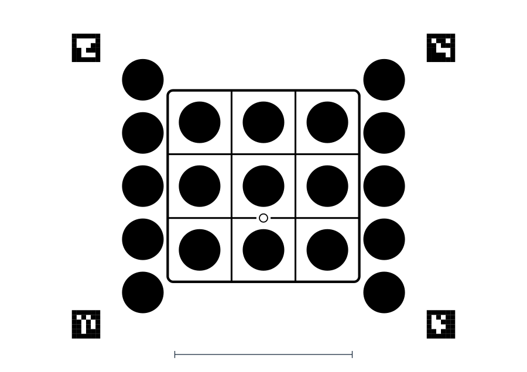

The Dobot Magician reaches circles **130 to 310 mm** from its base, and during a game it waits **off the
mat**, between its base and the mat, and the camera reads the mat while it is there. The compact mat's two
banks are 200 mm apart, so it fits that only in a few placements. The **small A4 mat** is packed to fit:

* Put the Dobot facing the middle of a **long edge** of the sheet (either one), with the middle of the mat
  **207 to 234 mm** from the arm's base, about **220 mm** is a good aim. Turned up to 15 degrees either way,
  keep it 207 to 222 mm out. Facing a short edge leaves the arm nowhere to wait, so do not.
* Keep the area between the arm's base and the mat **clear at all times**. That is where the arm waits and
  moves, and the setup shows how far its resting place is from the nearest circle.

Setup names any circle that is out of reach, and warns if the resting place is too near the mat.

### Set up the physical game

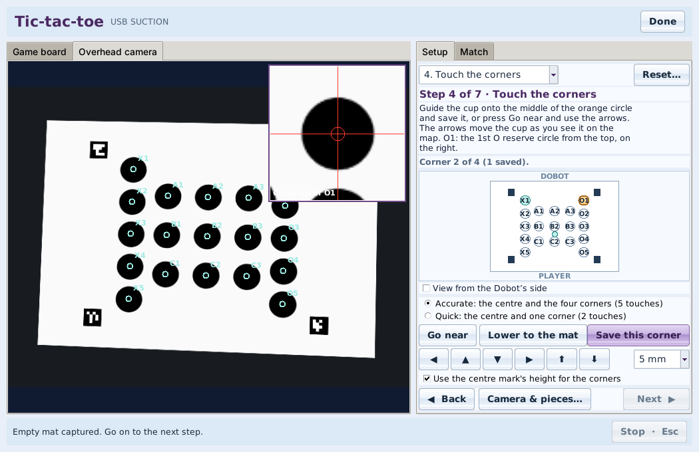

The **Setup** tab walks through seven steps. The map beside the steps and the camera view show which circle
each step means. If the camera is knocked during play, a warning appears and you only need to capture the empty mat
again. The arm's setup is not affected.

**The setup is saved by itself** as you go (what the arm was touched on, the nudges, the piece thickness, the pick depth,
the speed, the camera adjustments, what the camera was taught, and the picture of the empty mat it reads against), in
`~/.local/share/dobot-studio/training/tictactoe-setup/latest`. If the program closes or crashes, open Tic-tac-toe again,
home the arm, and press **Use the saved setup** on step 1: you land back at *Ready to play*. Use it **only if the mat,
the camera and the arm's base have not been moved**. If you are not sure, press **Check all points** to watch the arm visit
every circle. A saved setup is never written over before you choose: **Start fresh** (or capturing a new empty mat)
puts it aside as **Before the last reset**, which can still be brought back. **Reset…**, at the top of the Setup tab, begins
the whole setup again and asks whether to keep the saved copy or throw it away.

**Changing a small thing later.** Any step already reached can be gone back to from the list at the top of the Setup tab, and
**Back to the game** returns to the Match tab. Changing the piece thickness, the pick depth, the nudges and the arm's speed
does not need the setup done again. Touching a corner again, or capturing a new empty mat, does.

1. **Show the mat.** Secure the mat flat. Connect and home the Dobot on the first screen, with the suction
   cup fitted, then open **Tic-tac-toe**. Start the camera. Tic-tac-toe asks a USB camera for 1080p and reads a
   1280-wide picture. A camera that only does 640 × 480 still works. Move the mat or camera until it says
   **Good to go**. The four corner markers only find the mat once.
2. **Capture the empty mat.** Clear the mat and move the arm out of the camera's view. This locks the camera's
   view. After that the markers are not used again, so the arm passing in front of them, or a marker read a
   little out, changes nothing.
3. **Touch the centre mark.** Hand-guide the arm (hold its button) until the suction cup just touches the mat
   on the small ring in the middle, without pressing, and save it. That is the height of the mat, which is height
   zero for the arm. **Picking and placing add the thickness of a piece** to that height (3.2 mm for the Ø25 mm
   pieces, 5.12 mm for the Ø40 mm ones). The cup meets the top of a piece, and a piece held by its top has its
   underside on the mat at the same height. The arm's height limit follows the mat (the lowest touch less 5 mm),
   so a mat on a low table is not refused.
   **Printed scale (optional).** A paper mat has a 100 mm line at its foot. Printers can scale a sheet a little, so
   measure the printed line with a ruler (it should be within 5 mm of 100) and type it into **Printed line
   measures**. The arm then allows for it, and a Quick setup only has to find where the mat is and how it is
   turned, which makes it more accurate. Leave it empty if you did not measure it. The small mat's line has no
   number on it.
4. **Touch the corners.** Choose **Accurate** (the four outer circles, so five touches in all: the arm measures
   the mat's position, rotation, size and slope, and averages out small errors in your guiding) or **Quick** (one
   corner: the camera is looking straight down, so the arm already knows which way the mat is mirrored, and takes
   the mat as flat). Quick is faster but nothing checks its two touches: a 1 mm slip becomes about 2 mm typically
   and up to about 7 mm at the far circles. Touch more corners on the map afterwards and it becomes the full fit.
   The camera cannot replace the touches: it knows where each circle is in the picture, but only the arm's own touches
   say how the picture relates to the arm's coordinates. The circles are large, so a few millimetres either way is
   fine. A touch 4 mm or more from where the others put it shows an amber warning and you can go on. A slip of
   10 mm or more (usually the wrong circle) stops the setup. It is named, and you can click it on the map and touch
   it again, or choose **Use these points anyway**.
   *Helps:* the camera view shows a **close-up of the circle** from straight above, with a red crosshair on its
   centre: when the cup covers it, the cup is on the point. Or **move by buttons**: once the centre mark is saved,
   corners are saved at its height whatever height the cup is at (untick *Use the centre mark's height* to save
   the height you touched). **Go near** lifts the cup and carries it to where the circle should be (a rough guess
   after one touch, which assumes the Dobot is at the top edge of the mat on the map, and good to a few millimetres
   after two). The **arrows** move the cup a step across the mat as it looks on the map and the close-up (turned
   if you tick *View from the Dobot's side*), ⬆ ⬇ move it up and down, **Lower to the mat** puts it at the mat's
   height for a last look, and **Save this corner** keeps it. If any circle would be beyond the arm's reach,
   the step says which one. If the arm refuses a move, the reason is shown and the arm stays connected and homed.
5. **Check every point.** Press **Check all points**. The arm visits all 19 circles a little above the mat, then
   goes to its resting place. Click any circle on the map to look at it: **Go to selected**, **Lower** the cup onto it
   (it stops at the top of a piece), and **nudge** it by 0.5, 1 or 2 mm if it is off centre. If your printed pieces
   are not the size shown, change **Piece thickness** with the − and + buttons, and every pick and place height
   follows. If you stand behind the mat with the Dobot, tick **View from the Dobot's side**. The map and its
   wording turn end for end to match what you see.
6. **Check the pieces.** The arm moves to its **resting place**, off the mat, and the camera takes a second look with
   the arm there. The step says how far the resting place is from the nearest circle. Move it with the arrows
   if it is too close. Put **five X pieces in the X bank and five O pieces in the O bank**, one on each circle, and
   press **Capture pieces**. Only the two banks are checked: every circle must hold a piece, and every piece must
   be the mark its bank holds. Each circle that is not right is named, with why (*has no piece*, *holds O, not X*,
   or *cannot be read* and the camera's reason), and the camera view shows that circle now beside the same place
   when the mat was empty. The banks are marked green or red. The nine grid circles are not checked: they hold no
   pieces yet, and a note only mentions anything on them. The rings and writing on the camera view are drawn on the
   screen afterwards and are never on the picture the camera reads. The reading copes with the camera's automatic
   exposure, a slightly soft picture and a picture that slips a few pixels. Then finish.
7. **Ready to play.** Open the **Match** tab.

#### Paper tokens to cut out

Two sheets, each **A4 portrait** with **15 crosses and 15 noughts**, Ø25 mm, solid black marks, drawn from the same
numbers as the 3D pieces and the camera's reading:

* [tokens-cutout.pdf](printables/tictactoe/tokens-cutout.pdf): white tokens. Black on white is the strongest picture
  the camera can have.
* [tokens-cutout-colour.pdf](printables/tictactoe/tokens-cutout-colour.pdf): **pink crosses and yellow noughts**. The
  camera can tell these apart by colour as well as by mark (see *Colours* below).

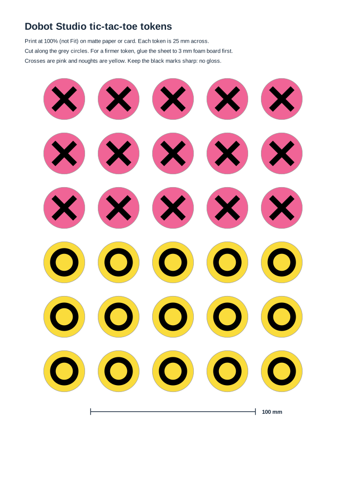

Print at **100%, not Fit**, on **matte** paper or card (check the 100 mm line), and cut along the grey circles. For a
firmer token that the suction cup can lift, glue the sheet to **3 mm foam board** before cutting: that is the
thickness the setup expects. For plain paper or card, press **Paper** beside the piece thickness in step 5 (0.4 mm).
Every token on both sheets reads correctly in the tests, so if paper tokens read and your 3D pieces do not, the
pieces are the problem (see below), not the software.

#### Colours

**Make the X pieces one colour and the O pieces another**, clearly different (pink and yellow, say), with black marks.
Colour is a second, stronger way to tell them apart, and it keeps working when a reflection or a soft picture hides
the mark. To use it, take the pictures **from a distance** in **Camera & pieces… > Teach the pieces**: with only X
pieces on the mat press *From a distance of an X*, then with only O pieces press *From a distance of an O*. The camera
learns each mark's shapes and the colour of its pieces. The colour is judged against the paper around the circle, so
it holds when the camera dims or tints the whole picture.

* When the colours are clearly different, a piece whose mark cannot be made out is read by its colour, and a piece
  whose mark and colour **disagree** (an O mark on an X-coloured piece) is flagged instead of trusted.
* If the X and O colours are too alike, the camera says so and carries on with the shapes only.
* Each bank circle in the window shows a small swatch of the piece's colour, as the Pi judges it.

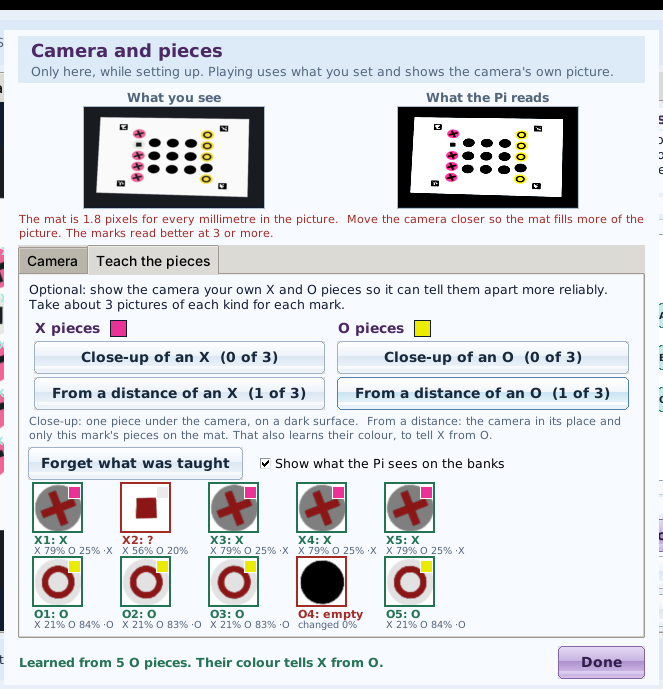

#### If the camera cannot read the pieces

Teaching helps the camera when it can already **see the mark** and the shape is simply not the ideal one. It cannot
help when the mark does not show up in the picture at all. Look in **Camera & pieces… > Teach the pieces**, where each
bank circle is shown as the Pi sees it, with the mark it found in red, the verdict, and how well it matched an X
and an O, then check these:

* **The camera says "Wait for a steady view" or "Something is in the way".** The camera reads the mat only when it is
  still and clear. **New game** and **Reset board** first take the arm to its resting place, because after homing the arm
  is usually in the picture. Keep the rest of the area clear. The camera allows for its automatic exposure changing when
  coloured pieces are put down, ignores a piece being a few millimetres off its circle, and ignores one odd frame. If it
  still waits, the message names the circles that keep changing (a reflection or a piece half on its circle is the usual
  cause) or says something is in the way (a hand, a cable, the arm).
* **The overlay rings do not sit on the tokens.** A webcam bends the picture between the four corner markers, so a flat map
  from the markers can put a circle a few millimetres from where it really is. The camera therefore measures where each
  black circle is in the picture of the empty mat and reads each circle there. The arm does not use this: it goes where it
  was touched. So a ring that is a little off a token does not matter, and the camera only needs to notice what is on a circle.
* **A piece off the middle of its circle.** A piece is never exactly on the middle: it is put down by hand, and a
  piece 3 mm thick leans away from the middle of the picture. The camera finds the piece's own middle from the edge of its
  body against the black circle, then looks for the mark there, and reads pieces up to about 5 mm off. Further than that it
  says the piece is *partly on this circle*: centre it.
* **Glossy pieces.** A first-layer face printed against a smooth plate is shiny, and a light overhead reflects off it
  as a bright patch that wipes out the mark. Light from the side, or print the pieces on a textured plate, or use the
  paper tokens. In the circle picture a reflection shows as a white patch with the red mark broken up or missing.
* **A piece that is not much lighter than the black circle** (dark blue, dark red, dark green). Pieces must be
  clearly lighter: white, yellow, light pink. The circle then says *changed* a small percentage, or *partly on this
  circle*.
* **A reflection or soft picture hiding the marks.** If the X and O pieces are different colours, teach the colours
  from a distance (see *Colours*): the colour then reads them when the marks cannot be seen.
* **A mark that is not dark.** A coloured mark on a coloured body can have the same brightness as the body, and
  disappears when the camera drops colour. The circle says *mark* with a very small number of pixels. Use a black mark.
* **A mat that is too small in the picture.** The setup says how many pixels each millimetre is. An X's arms are
  3.3 mm wide, so below about 2 pixels per millimetre or with any softness they smear. Move the camera closer so
  the mat fills more of the picture, aim for 3 or more, and use **Sharpen** and **Lock exposure, focus and colour**.
* **Focus or exposure that keeps changing.** Use **Lock exposure, focus and colour** after the picture looks right.

#### Camera and pieces (setup only)

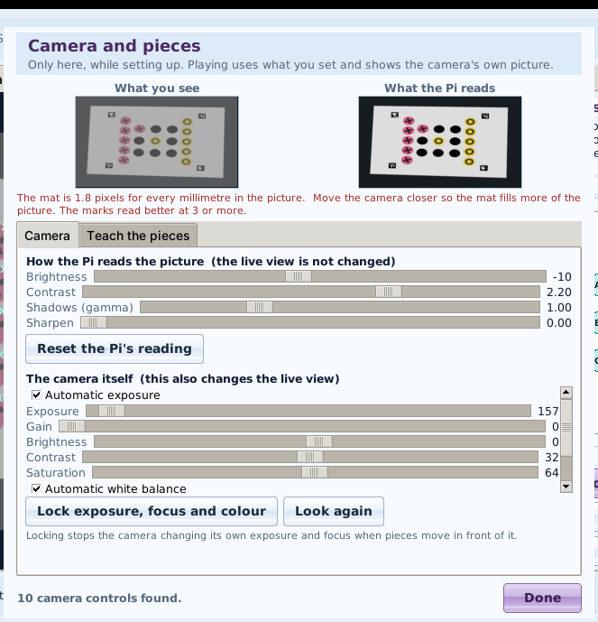

**Camera & pieces…** is in the setup steps only. It is not on the Match tab, so players see the camera's own
picture. What it sets is what the Pi reads, and it is saved with the setup.

* **How the Pi reads the picture** (brightness, contrast, shadows and sharpening) changes only what the Pi sees,
  never the live picture. The two pictures at the top show *What you see* beside *What the Pi reads*. If a mark
  is faint, add contrast. Changing it after the empty mat was captured is fine: the empty mat is seen through the
  same adjustment, and nothing needs capturing again.
* **The camera itself** lists the camera's own controls (exposure, focus, white balance, gain and so on). These change
  what the camera sends, so they change the live view too. **Lock exposure, focus and colour** stops the camera
  changing its own settings when pieces move in front of it, which is the usual cause of readings that come and go.
  They use `v4l2-ctl`, which `setup-pi.sh` checks for (`sudo apt install v4l-utils`).
* **Teach the pieces** (optional) shows the camera your own X and O pieces. For each mark, take about three
  **close-ups** (one piece under the camera, on a dark surface, filling most of the picture) and about three
  pictures **from a distance** (the camera in its place, and only X pieces, or only O pieces, on the mat). The
  camera keeps the shape of each mark. It only asks those shapes when its built-in reading is not sure, so teaching
  can help a reading and never break one that already works. It warns if the X and O shapes look alike.

### Playing

**If the Dobot does not pick a piece up.** In step 5 the **Pick depth** (+ and −, 0.5 mm at a time, from 5 mm higher to
12 mm deeper) is how far past the top of a piece the cup goes before the suction comes on. Press **Test pick**: the arm
picks up the first piece of its bank, lifts it, holds it for a moment, and puts it back, so you can see whether it took hold.
Put a piece on that circle first. Go deeper with + until it does. A pick that presses too hard is better a little higher. The
setting is used for every pick in the game and is saved with the setup.

7. Choose **Play as**. For the paper mat, load X1–X5 with crosses and at least four of O1–O5 with noughts. On the
   single-bank mat, put the Dobot's mark in the reserve slots. Load five if it plays X or four if it plays O. Select
   **New game**.
8. On your turn, centre one piece in an empty cell and take your hand away. The Dobot's arm is waiting **off the
   mat**, so the camera sees all of it. Once the camera sees one legal move and a clear, unchanged mat for 1.5
   seconds, the screen says the camera has read the mat, the Dobot **thinks** for a moment, and only then does it
   move. A change, obstruction or lost camera view restarts the countdown. If you play O, the Dobot opens after the
   same check.
9. **Arm speed** (the slider on the Match tab, 30% to 200%) sets how fast the arm moves: 100% goes down to a piece and up
   at 25 mm/s, and between them at 60 mm/s. The Dobot fetches its piece, places it, and goes **back to its resting place**. The camera verifies the destination
   and the cleared reserve slot after the transfer. Keep hands clear of the arm's path and keep the resting area
   clear. Use **Stop** or Escape to interrupt. Support any held piece before using **Release suction**. Watch the first
   lift and placement to check reach and suction.
10. When the game ends, leave the mat still and clear. After 1.5 seconds the Dobot returns each piece from the cells
   to a free reserve slot, one at a time, and the camera confirms every move before the next. On the paper, A3 and
   compact mats it returns both marks to their own banks. On the single-bank 3D mat it returns only its own pieces, so
   take your pieces off the mat yourself. When the screen says **Board reset**, check the reserves and choose **New
   game**. Untick **Reset the board after each game** to tidy by hand, or click **Reset board** to run the reset
   whenever you like, even in the middle of a game (that game ends). If you took the pieces off yourself, click
   **I cleared the board by hand**: the game is forgotten and the arm does not move. **Stop** or Escape cancels it. If a move is not confirmed, or a reserve
   bank has no free slot, the reset stops and says why.

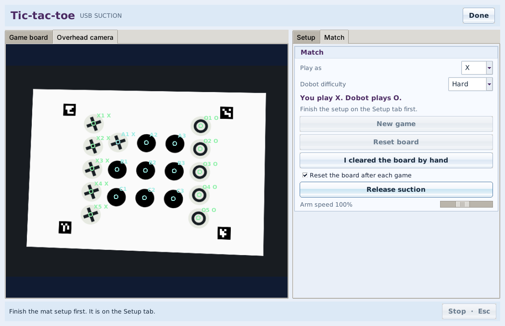

The camera and suction examples use simulated hardware. Print scale, camera
contrast, reach and suction sealing need checking with the physical setup.

## References

- The [Electromaker tutorial](https://www.electromaker.io/project/view/kicker10bogdobotmagicianserver) informed the Pi USB setup, serial port selection and homing workflow.
- The [pydobot driver](https://github.com/luismesas/pydobot) and [Dobot Magician serial protocol](https://download.dobot.cc/product-manual/dobot-magician/pdf/en/Dobot-Communication-Protocol-V1.1.5.pdf) informed the standalone serial adapter.
- The [CircuitPath theme](https://github.com/jackallen28/BNTS_Circuit_Pathways/blob/BNTS_CircuitPath/ui/theme.css) informed the desktop styling.
- The [MediaPipe Python setup guide](https://developers.google.com/edge/mediapipe/solutions/setup_python), [Gesture Recognizer](https://developers.google.com/edge/mediapipe/solutions/vision/gesture_recognizer) and [Pose Landmarker](https://developers.google.com/edge/mediapipe/solutions/vision/pose_landmarker) cover the tracking models.

- The [Dobot Vision Kit starter guide](https://github.com/SERLatBTH/StarterGuide-DobotMagicianVisionKit/tree/master) informed the three-point camera-to-robot calibration, colour sorting and taught bin workflow.
